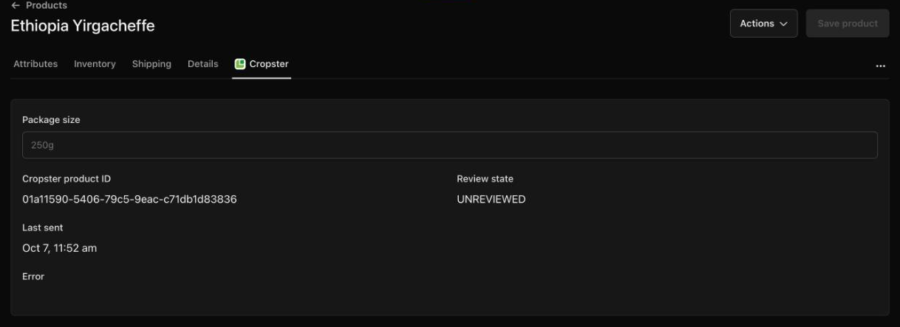
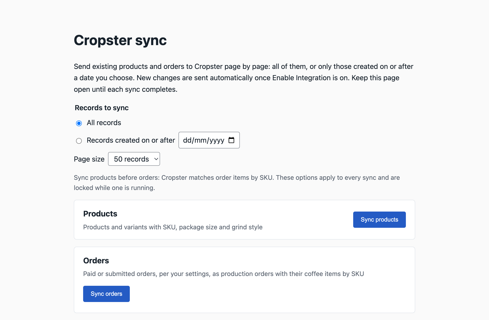
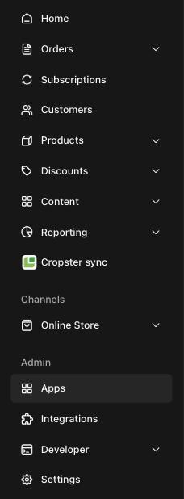
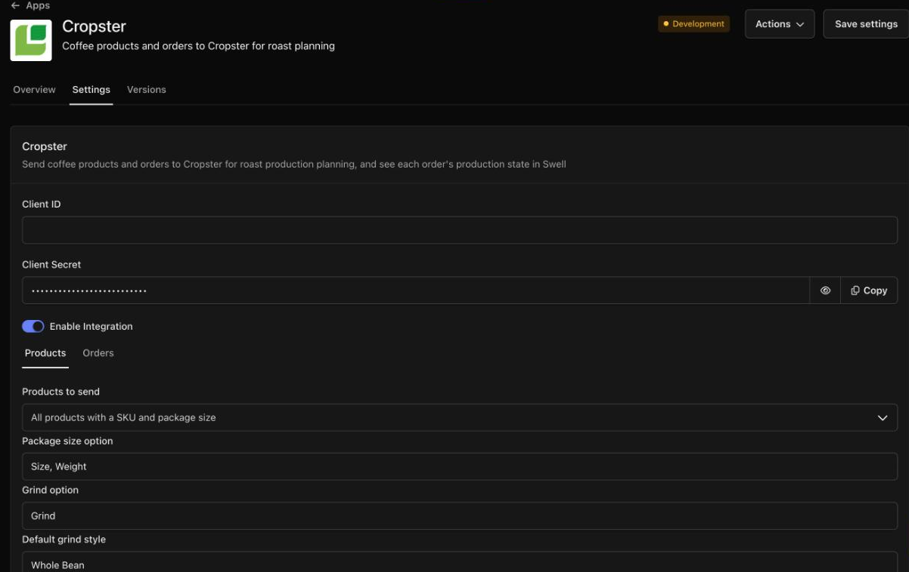

# Cropster integration

A Swell app that sends coffee products and orders to [Cropster](https://www.cropster.com/) for roast production
planning, and shows each order's Cropster production state in Swell.

## Features

All calls go to the [Cropster RPC API v1](https://docs.cropster.com/api/rpc/reference) (`https://api.cropster.com/rpc/v1`)
with an OAuth 2.0 client credentials token (`https://auth.cropster.com/oauth2/token`, scopes `mrp.product mrp.order`).
The token is cached for its lifetime (8 hours) while the Worker isolate lives. Rate limited calls (HTTP 429) are retried
twice, after 1 and 2 seconds.

### Real-time sync

| Swell event                                     | Cropster operation                        | Function                      |
| ----------------------------------------------- | ----------------------------------------- | ----------------------------- |
| `product.created`, `product.updated`            | `mrp.product.syncProducts`                | `functions/product-events.ts` |
| `product.variant.created`, `product.variant.updated` | `mrp.product.syncProducts` (parent product) | `functions/product-events.ts` |
| `order.paid` (or `order.submitted`, see settings) | `mrp.order.setOrders` (create)          | `functions/order-events.ts`   |
| `order.updated` with changed items              | `mrp.order.setOrders` (update while OPEN) | `functions/order-events.ts`   |
| Every 30 minutes                                | `mrp.order.listOrders` (changed orders)   | `functions/order-status.ts`   |

Events are processed only when **Enable Integration** is on and the Client ID and Client Secret are set. The status
the app writes on records uses `$events: false`, and status-only product updates are ignored, so syncs never loop.

**Products** – `externalId` is the Swell product ID. One Cropster variant is sent per active Swell variant (or the
product itself when it has no variants) with:

- `sku` – the variant SKU (or product SKU). Variants without a SKU are skipped.
- `coffeeOptions.packageSize` – parsed from the value of the variant's package size option (option names from the
  **Package size option** setting, `Size, Weight` by default). Values like `250g`, `340 grams`, `1 kg`, `1.5kg`,
  `12 oz`, `2 lb`, `5 lbs` or `1/2 lb` are recognized and matched to Cropster's package sizes, also across units
  (`1000g` → 1 kg, `32 oz` → 2 lbs). When no option holds a size, the product's **Package size** field, the variant
  name and the product name are tried in that order. Variants without a recognized size are skipped.
- `coffeeOptions.grindStyle` – the value of the grind option (**Grind option** setting, `Grind` by default), or
  **Default grind style** (`Whole Bean`).

A product with no variant to send (e.g. merchandise without a size) is not sent; the reason is stored in its
Cropster tab. The Cropster product ID and review state (`REVIEWED`/`UNREVIEWED`) are stored on the product. With
**Products to send** set to marked products, only products with **Send to Cropster** on are sent.

**Orders** – sent when the order is paid (default) or submitted, and not canceled or a draft:

- `externalId` – the Swell order number; `orderDate` – the order creation date.
- `customer` – billing or shipping company, else the account or billing name.
- `customerType` – `WHOLESALE` when the customer's account group matches **Wholesale customer group**, otherwise
  **Customer type** (`RETAIL` by default).
- `orderItems` – SKU and quantity of each item whose product is sent to Cropster; items with the same SKU are
  added up. Orders without such items are not sent.

The Cropster order ID, state and status are stored on the order and shown on its **Cropster** tab. Orders that
Cropster has started processing (state other than `OPEN`) are not sent again, because Cropster only accepts changes
while an order is open.

**Order status** – every 30 minutes `order-status` reads Cropster orders changed in the last 2 hours (up to 2,000) and
copies `state` (`OPEN`, `SCHEDULED`, `IN_PROGRESS`, `ROASTED`, `COMPLETED`), `status` and the change date to the Swell
order with the same number. Orders created in the Cropster UI are ignored.

**Batches** – Cropster accepts 50 records per request and rejects the whole request if one record is invalid
(`bulk_operation_failed`). The app then resends that batch one record at a time, so valid records still go through and
each invalid one gets its own error. Credential, rate limit and server errors stop the sync instead. Errors are stored
in the record's **Error** field in its Cropster tab.

### Dashboard

- **Cropster tab** on products: Send to Cropster (marked mode only), Package size, Cropster product ID, review state,
  last sent time and error.

  

- **Cropster tab** on orders and a **Cropster** column in the order list: state, fulfillment status, Cropster order
  ID, change date, last sent time and error.
- **Send to Cropster** in the Actions menu of a product or order, and as a bulk action on selected products or orders
  (up to 50), sends them right away and shows how many were sent, skipped or failed.
- **Test connection** in the app's Actions menu checks the credentials by requesting a token and reading one order.

### Initial sync page

The **Cropster sync** item in the dashboard sidebar opens the app frontend (`frontend/`), where the merchant sends
existing products and orders to Cropster. Run it once after installing: Cropster matches order items by SKU, so
products must be synced before orders.



- **Shared options** for every sync: all records, or only records created on or after a date; and the page size
  (10, 25 or 50 records, Cropster's maximum per request).
- **One row per entity** – Products and Orders – each with **Sync**, **Stop** and **Resume from page N** buttons, a
  progress bar, the number of records sent, skipped and failed, the list of records not sent with the reason, and
  error details if a page fails.
- The page calls the app Worker one page at a time (`POST /app-api/admin/sync`). Each call reads one page from Swell
  (sorted by creation date so pages stay stable), sends it to Cropster and stores the result on the records.
- The Worker only accepts same-origin JSON requests from a validated staff session of the store.



## Settings

Configured in the app settings (`settings/cropster.json`), under **Apps → Cropster → Settings**. Credentials are never
stored in code.



| Setting           | Type   | Required | Default        | Description                                                                        |
| ----------------- | ------ | -------- | -------------- | ---------------------------------------------------------------------------------- |
| `client_id`       | text   | yes      |                | Client ID of a Cropster service account with the `mrp.product` and `mrp.order` scopes. |
| `client_secret`   | secret | yes      |                | Client Secret of that service account.                                             |
| `enabled`         | toggle | no       | off            | Real-time sync, order status updates, the sync page and Send to Cropster.          |
| `products`        | select | no       | `all`          | Products to send: `all` with a SKU and package size, or only `marked` ones.       |
| `size_option`     | text   | no       | `Size, Weight` | Product option names holding the package size, comma separated.                   |
| `grind_option`    | text   | no       | `Grind`        | Product option names holding the grind style, comma separated.                    |
| `default_grind`   | text   | no       | `Whole Bean`   | Grind style for variants without a grind option.                                   |
| `send_orders_on`  | select | no       | `paid`         | Send orders when they are `paid` or `submitted`.                                   |
| `customer_type`   | select | no       | `RETAIL`       | Customer type of production orders.                                               |
| `wholesale_group` | text   | no       |                | Account group ID whose orders are sent as `WHOLESALE`.                             |

## Setup

1. Create a Cropster service account. It requires the Cropster API Integration add-on; to get it, contact
   [api@cropster.com](mailto:api@cropster.com).
   1. Log in to Cropster (C-sar), click the **gear icon** at the top right, choose **Account**, then **API Access** in
      the left menu.
   2. Click **Add service account**, enter a descriptive name (e.g. `Swell`), and in **Scopes** select `mrp.product`
      and `mrp.order`.
   3. Click **Create service account** and copy the Client ID and Client Secret. The secret is shown only once.

   Sandbox and production credentials are separate and don't work in the other environment: create the service
   account in the Cropster account you want to send data to.
2. Install the Swell CLI and log in:

   ```bash
   npm install -g @swell/cli
   swell login
   ```

3. Install dependencies and push the app to your store's test environment:

   ```bash
   cd /path/to/cropster-integration
   npm install
   swell app push
   ```

4. In the Swell dashboard open **Apps → Cropster → Settings**, enter the Client ID and Client Secret, check the option
   names and order settings, save, and run **Actions → Test connection**. Then turn on **Enable Integration**.
5. Open **Cropster sync** in the dashboard sidebar and sync products, then orders. Review new products in Cropster
   (they arrive as `UNREVIEWED`) before their orders are produced.
6. To install in the live environment, create a version and install it:

   ```bash
   swell app version minor
   swell app install
   ```

## Limits and known behavior

- **Coffee products only** – Cropster needs a package size from its fixed list for every variant. Products and
  variants whose size can't be recognized are skipped with an error on the product.
- **Variants are immutable in Cropster** – once created, a variant's package size and grind can't be changed through
  the API. Products and variants are never deleted in Cropster; delete them there if needed.
- **No cancellations** – the Cropster API has no way to cancel or delete orders. Cancel canceled Swell orders in
  Cropster manually.
- **Orders are frozen once in production** – changes made in Swell after Cropster scheduled an order are not sent.
- **Status is polled** – production states reach Swell within about 30 minutes. If the app is disabled for more than
  2 hours, changes in that gap are picked up only when the order changes again in Cropster.
- **Keep the sync page open** – the sync runs in the browser page by page; closing the page stops it. Use
  **Resume from page N** to continue.
- **Rate limits** – Cropster allows 5 requests per second on average. Large real-time bursts (e.g. bulk product
  imports) may be rate limited; failed events are retried by Swell, and the sync page can resend everything.

## Development

### Project layout

```
functions/
  product-events.ts   # product and variant changes → mrp.product.syncProducts
  order-events.ts     # order.paid / submitted / updated → mrp.order.setOrders
  order-status.ts     # cron every 30 min: mrp.order.listOrders → Swell order status
  send-to-cropster.ts # dashboard action: send products or orders now
  test-connection.ts  # settings action: check credentials
  lib/
    cropster.ts       # OAuth client, token cache, retries, errors, batch sending
    products.ts       # package size parsing, product mapping and sync
    orders.ts         # order mapping, sync and status polling
    sync.ts           # page-by-page sync used by the sync page
frontend/             # initial sync page (React) and app Worker, hosted by Swell
models/               # Cropster fields on products and orders; placeholder syncs collection
content/              # Cropster tabs, list column, actions and the sidebar entry
settings/cropster.json
assets/icon.png       # app icon (Cropster mark)
assets/image.png      # social card (1200×630)
assets/images/        # App Store listing images, listed in swell.json "images"
assets/screenshots/   # dashboard screenshots used in this README
test/unit/            # vitest unit tests (Cropster API mocked)
test/integration/     # vitest tests against the store using CLI auth
```

### Commands

```bash
npm run typecheck   # TypeScript check for functions, tests and the frontend
npm test            # run all vitest tests
swell app dev       # run functions locally, triggered by the test environment
swell app push      # deploy to the test environment
swell logs -f --app cropster      # follow function logs
swell inspect functions --app=.   # check deployed functions and failures
```

Tests run in the Cloudflare Workers runtime via `@cloudflare/vitest-pool-workers` and use your `swell login` session
(or `SWELL_STORE_ID` / `SWELL_SESSION_ID` in CI). Unit tests mock `fetch`, so no real Cropster calls are made.

## Contributing

Contributions are welcome! Visit the [Swell Discord](https://discord.gg/VakSbyjDGZ) or [GitHub discussions](https://github.com/orgs/swellstores/discussions/) to get help and share ideas.

## License

Swell App License. See [LICENSE](LICENSE).
